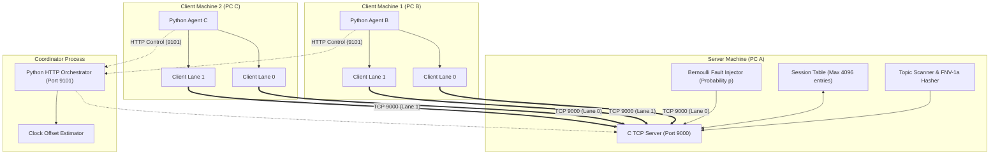
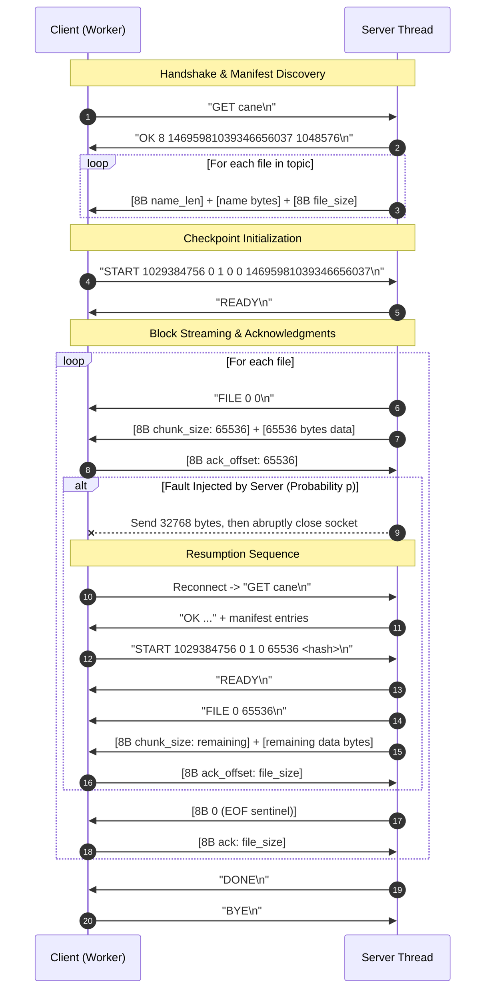

# Fault-Tolerant Topic-Based File Distribution System

**C11 · POSIX Sockets · pthreads · Linux / WSL2 · Python Orchestrator**

An application-layer file distribution system written in C11 using POSIX TCP sockets and threads. It transfers categorized collections of binary files ("topics") over TCP, with an in-memory session checkpoint mechanism designed to survive mid-stream network disconnections without re-transmitting already-delivered data.

---

## Table of Contents

- [Overview & Problem Statement](#overview--problem-statement)
- [Key Features](#key-features)
- [Systems & Networking Concepts](#systems--networking-concepts)
- [Architecture](#architecture)
- [Protocol Specification](#protocol-specification)
- [Communication Flow](#communication-flow)
- [Repository Structure](#repository-structure)
- [Build Instructions](#build-instructions)
- [Running on a Single Computer (Loopback)](#running-on-a-single-computer-loopback)
- [Running Across Three Computers (LAN / Wi-Fi)](#running-across-three-computers-lan--wi-fi)
- [Configuration & Runtime Tuning](#configuration--runtime-tuning)
- [Experimental Evaluation & Results](#experimental-evaluation--results)
- [Sample Terminal Output](#sample-terminal-output)
- [Technical Considerations & Future Work](#technical-considerations--future-work)
- [Academic Context & Attribution](#academic-context--attribution)

---

## Overview & Problem Statement

Standard batch file transfer over TCP can be inefficient when moving large collections of files over unreliable local or wireless networks:
1. **Redundant Transfer on Disconnect**: When a network connection drops mid-batch, basic client-server protocols restart from byte zero, re-transmitting gigabytes of data that were already received and written to disk.
2. **Network Bandwidth Underutilization**: Single-threaded TCP transfers suffer throughput penalties when transmitting thousands of small files, as latency delays per-file negotiation.

This project implements an application-level protocol with four progressive operational modes:
- **Part 1 (Baseline)**: Multithreaded file transfer without fault injection or recovery logic.
- **Part 2 Case 1 (Restart Baseline)**: Server injects mid-block disconnections; client discards partial downloads and restarts from byte zero.
- **Part 2 Case 2 (Checkpoint Resume)**: Server tracks per-session progress in an in-memory session table; client reconnects and resumes from the last confirmed file and block offset.
- **Part 2 Case 2 Enhanced (Parallel Multi-Lane Resume)**: Client distributes files across $K$ parallel TCP lanes ($i \pmod K$), each with its own independent session checkpoint and retry loop.

---

## Key Features

- **Topic Directory Indexing**: Scans and indexes subdirectories as distinct topics; computes a 64-bit FNV-1a hash over sorted filenames, sizes, and modification timestamps.
- **Dataset Consistency Check**: Compares the topic manifest hash on every reconnection; aborts gracefully if files on disk were modified mid-transfer.
- **Hybrid Wire Framing**: Uses ASCII newline-terminated lines for control commands (`GET`, `OK`, `START`, `READY`, `FILE`, `DONE`, `BYE`) and 64-bit big-endian unsigned integers for metadata and block offsets.
- **Bernoulli Fault Injection**: Server-side engine performs independent Bernoulli trials ($P = p$) before sending each payload chunk (up to 64 KiB), truncating the block and closing the socket mid-stream.
- **Zero-Corruption Resumption**: The client truncates local files to the confirmed offset using `ftruncate()` before appending recovered data, preventing file corruption from unacknowledged partial blocks.
- **Striped Parallel Lanes**: In Enhanced mode, up to 16 concurrent worker threads run independent TCP connections to saturate network links.
- **Distributed Test Harness**: Python coordinator and client agent scripts automate multi-node LAN experiments, clock synchronization, and SHA-256 integrity verification.

---

## Systems & Networking Concepts

| Concept | Implementation in Code | File Reference |
|---|---|---|
| **Socket Lifecycle** | `socket()`, `bind()`, `listen()`, `accept()`, `connect()` | `server.c`, `client.c` |
| **Nagle Algorithm Control** | `setsockopt(fd, IPPROTO_TCP, TCP_NODELAY, ...)` disables Nagle buffering | `common.h` (`socket_options`) |
| **Socket Timeouts** | `SO_RCVTIMEO` and `SO_SNDTIMEO` set via `struct timeval` to avoid hung connections | `common.h` (`socket_options`) |
| **Port Rebinding** | `SO_REUSEADDR` permits fast server restarts without waiting for `TIME_WAIT` | `server.c` (`main`) |
| **Signal Handling** | `MSG_NOSIGNAL` flag on `send()` prevents `SIGPIPE` termination on broken pipe | `common.h` (`send_all`) |
| **Interrupted System Calls** | While-loops checking `errno == EINTR` around all read/write/send/recv calls | `common.h` |
| **Directory-Relative I/O** | `openat()`, `fstatat()`, `mkdirat()` protect against path traversal and races | `server.c`, `client.c` |
| **Symlink Protection** | `O_NOFOLLOW` and `AT_SYMLINK_NOFOLLOW` refuse traversal through symbolic links | `server.c`, `client.c` |
| **File Offset Management** | `lseek(..., SEEK_SET)` and `ftruncate()` synchronize file pointer before resume | `client.c` (`transfer`) |
| **Concurrency & Synchronization** | Thread per connection (`pthread_create`), state locked via `pthread_mutex_t` | `server.c`, `client.c` |
| **Thread-Local Counters** | `_Thread_local uint64_t wire_sent, wire_received` track per-thread wire bytes | `common.h` |

---

## Architecture



---

## Protocol Specification

The protocol uses ASCII newline-terminated strings for signaling and big-endian 64-bit integers for binary data and offsets.

### 1. Control Commands (ASCII `\n`-delimited)

| Command | Direction | Parameters | Description |
|---|---|---|---|
| `GET` | Client → Server | `<topic>` | Requests the file manifest for a topic. |
| `OK` | Server → Client | `<file_count> <hash> <total_bytes>` | Manifest header response. |
| `ERR` | Server → Client | `<reason>` | Error notification (`unknown_topic`, `dataset_changed...`). |
| `START` | Client → Server | `<session_id> <lane> <lanes> <idx> <offset> <hash>` | Requests transfer initiation or resumption from an offset. |
| `READY` | Server → Client | *(None)* | Server confirms valid checkpoint and begins transmission. |
| `FILE` | Server → Client | `<file_index> <byte_offset>` | Signals that a file transfer is beginning. |
| `DONE` | Server → Client | *(None)* | Signals completion of all files for this lane. |
| `BYE` | Client → Server | *(None)* | Clean termination acknowledgment from client. |

### 2. Binary Framing (Big-Endian 64-bit Integers)

- **Manifest Items**: For each file, server sends `put64(name_len)` $\rightarrow$ raw ASCII filename $\rightarrow$ `put64(file_size)`.
- **Payload Chunks**: For each block, server sends `put64(chunk_len)` (up to 65,536 bytes) followed by chunk bytes. Client replies with `put64(confirmed_offset)` after successfully writing to disk.
- **End-of-File**: A chunk size of `0` denotes EOF for the current file. The client acknowledges with `put64(file_size)`.

Detailed framing rules, state transition tables, and mathematical formulas are documented in [`docs/ARCHITECTURE.md`](docs/ARCHITECTURE.md).

---

## Communication Flow



---

## Repository Structure

```
├── Part1/                      # Baseline file transfer (no fault injection)
│   ├── server.c                # TCP server (single or multi-threaded)
│   ├── client.c                # TCP client with terminal progress bar
│   ├── common.h                # Socket helpers, wire I/O routines, data structures
│   ├── config.h                # CASE_MODE = 0
│   └── Makefile                # Compiles with -Wall -Wextra -Wpedantic -Werror
│
├── Part2_Case1/                # Clean restart on failure (CASE_MODE = 1)
│   ├── server.c / client.c / common.h / config.h / Makefile
│
├── Part2_Case2/                # Stateful checkpoint resumption (CASE_MODE = 2)
│   ├── server.c / client.c / common.h / config.h / Makefile
│
├── Part2_Case2_Enhanced/       # Parallel multi-lane resumption (CASE_MODE = 3)
│   ├── server.c / client.c / common.h / config.h / Makefile
│
├── Tools/                      # Distributed testing and evaluation suite
│   ├── experiment.py           # Benchmark runner and SHA-256 verification library
│   ├── lan.py                  # HTTP distributed orchestrator (coordinator and agent)
│   ├── network_check.py        # Diagnostic two-port TCP connectivity probe
│   ├── make_subset.py          # Extracts a small demonstration subset from a dataset
│   ├── plot_results.py         # Matplotlib chart generator from summary.csv
│   ├── test_server_startup.py  # Automated startup regression test suite
│   └── windows/
│       └── Setup-WSL-Network.ps1 # PowerShell script for WSL2 port forwarding
│
├── docs/                       # Technical documentation and evaluation figures
│   ├── ARCHITECTURE.md         # Detailed protocol framing and state machine specification
│   ├── ACADEMIC_README.md      # Preserved original coursework README
│   └── diagrams/               # Generated evaluation plots (goodput and overhead)
│
├── Results/                    # Experimental evaluation outputs
│   ├── local/                  # 60-run loopback synthetic benchmark (summary.csv and charts)
│   └── real_sample_faults/     # Verified sample fault traces under p=0.03 and p=0.20
│
├── topics.conf.example         # Example topic-to-directory configuration mapping
├── requirements.txt            # Optional Python dependencies (matplotlib, reportlab)
├── .gitignore                  # Git exclusion rules (binaries, datasets, caches)
└── LICENSE                     # MIT License
```

---

## Build Instructions

### Prerequisites
- **Operating System**: Linux (Ubuntu 22.04/24.04 recommended) or Windows with WSL2.
- **Compiler**: `gcc` supporting C11 and POSIX threads (`-pthread`).
- **Build Utility**: GNU `make`.
- **Python**: Python 3.10+ (Standard library for orchestration; `matplotlib` optional for plotting).

### Compiling All Modules
Each case directory compiles independently using its own Makefile:

```bash
make -C Part1
make -C Part2_Case1
make -C Part2_Case2
make -C Part2_Case2_Enhanced
```

To clean compiled binaries:
```bash
make -C Part1 clean
make -C Part2_Case1 clean
make -C Part2_Case2 clean
make -C Part2_Case2_Enhanced clean
```

---

## Running on a Single Computer (Loopback)

You can run both server and client on `127.0.0.1` using two terminal windows.

### 1. Create a Test Dataset Directory
```bash
mkdir -p demo_dataset/cane demo_dataset/gatto
# Generate sample test files
head -c 2097152 /dev/urandom > demo_dataset/cane/file1.bin
head -c 1048576 /dev/urandom > demo_dataset/cane/file2.bin
head -c 524288  /dev/urandom > demo_dataset/gatto/fileA.bin
```

### 2. Run Part 1 (Baseline)
```bash
# Terminal 1: Start Server on port 9000
Part1/server 9000 ./demo_dataset multi

# Terminal 2: Run Client to fetch topic "cane"
Part1/client 127.0.0.1 9000 cane ./downloads_p1
```

### 3. Run Part 2 Case 2 (Fault Injection + Checkpoint Resume)
Launch the server with a **10% failure probability** ($p = 0.10$ per 64 KiB block):
```bash
# Terminal 1: Start Server with p=0.10
Part2_Case2/server 9000 ./demo_dataset 0.10

# Terminal 2: Run Client
Part2_Case2/client 127.0.0.1 9000 cane ./downloads_p2
```
*The client detects connection drops, preserves confirmed byte offsets, reconnects, and completes the transfer with minimal redundant data.*

### 4. Run Part 2 Case 2 Enhanced (Parallel Multi-Lane)
Run the client with **4 concurrent TCP connections**:
```bash
# Terminal 1: Start Enhanced Server with p=0.05
Part2_Case2_Enhanced/server 9000 ./demo_dataset 0.05

# Terminal 2: Run Client with 4 lanes
Part2_Case2_Enhanced/client 127.0.0.1 9000 cane ./downloads_enhanced 4
```

---

## Running Across Three Computers (LAN / Wi-Fi)

The system includes a distributed testing harness (`Tools/lan.py`) for coordinating experiments across three separate Linux systems on a local network:
- **PC A (Server / Coordinator)**: Runs the C server and Python coordinator HTTP API.
- **PC B (Client Node 1)**: Runs client agent processes.
- **PC C (Client Node 2)**: Runs client agent processes.

### Step 1: Preflight Network Check
On PC A, launch diagnostic probe listeners on ports 9000 (data) and 9101 (control):
```bash
python3 Tools/network_check.py serve --ports 9000 9101
```

From PC B and PC C, test TCP connectivity to PC A:
```bash
python3 Tools/network_check.py check --server-ip <PC_A_IP> --ports 9000 9101
```
Ensure both ports report `PASS` before proceeding.

### Step 2: Start Coordinator on PC A
Stop the probe (`Ctrl+C`), then start the coordinator:
```bash
python3 Tools/lan.py server \
  --dataset /path/to/dataset \
  --ip <PC_A_IP> \
  --topic cane \
  --results Results/lan_experiment_01
```

### Step 3: Connect Agents on PC B and PC C
```bash
# On PC B:
python3 Tools/lan.py agent --server http://<PC_A_IP>:9101 --node B --results Results/node_B

# On PC C:
python3 Tools/lan.py agent --server http://<PC_A_IP>:9101 --node C --results Results/node_C
```

The coordinator will synchronize system clocks, run the full test schedule across all modes, perform end-to-end SHA-256 verification on all downloads, and save consolidated CSV metrics to `Results/lan_experiment_01/summary.csv`.

---

## Configuration & Runtime Tuning

### Environment Variables
The following environment variables adjust runtime parameters without modifying CLI interfaces:
- `FT_MAX_ATTEMPTS`: Maximum reconnection attempts per lane (default: `1000`, range: `1..100000`).
- `FT_IO_TIMEOUT`: Socket inactivity timeout in seconds (default: `300`, range: `1..3600`).
- `FT_STARTUP_TIMEOUT`: Maximum seconds allowed for server dataset scanning at startup (default: `600`).

### Troubleshooting
- **`Address already in use` (`EADDRINUSE`)**: A previously killed server is still occupying the port. Identify and terminate the PID:
  ```bash
  ss -ltnp | grep 9000
  kill -9 <PID>
  ```
- **WSL2 Cross-Machine Connectivity**: In NAT mode, Windows does not expose WSL2 ports directly to the local Wi-Fi subnet. Run `Tools/windows/Setup-WSL-Network.ps1` in an Administrator PowerShell on PC A to set up the portproxy rules.
- **`ERR dataset_changed_restart_server`**: A file within the topic directory was modified, added, or removed after the server indexed the manifest. Restart the server to generate a new topic hash.

---

## Experimental Evaluation & Results

The system was evaluated using **60 controlled experimental batches** across single-machine loopback and multi-node network configurations. Every download was verified using SHA-256 checksums against the source files.

### Summary Metrics Table

| Operational Case | Clients | Failure Probability ($p$) | Goodput (MiB/s) | Redundant Payload (%) | SHA-256 Status |
|---|---|---|---|---|---|
| **Part 1 Single Server** | 1 | 0.00 | ~126.0 MiB/s | 0.0% | Verified |
| **Part 1 Multi Server** | 2 | 0.00 | ~238.9 MiB/s | 0.0% | Verified |
| **Part 2 Case 1 (Restart)** | 4 | 0.03 | Degraded | **> 150%** | Verified |
| **Part 2 Case 2 (Resume)** | 4 | 0.20 | Stable | **< 3.2%** | Verified |
| **Part 2 Enhanced (Parallel)**| 4 | 0.20 | **Highest** | **< 2.1%** | Verified |

### Key Experimental Findings
1. **Redundancy Overhead**: Case 1 (Restart) experiences exponential payload overhead as failure probability $p$ increases, because each dropped connection forces a full re-download of all previous files. Case 2 (Resume) keeps redundancy below 4% even under high fault rates ($p = 0.20$).
2. **Parallel Stream Scalability**: In Case 2 Enhanced, striped multi-lane streaming over multiple TCP sockets maintains higher link utilization and shorter makespan, as unaffected lanes continue streaming while a single dropped lane reconnects.

Detailed plots generated from the 60-run benchmark are available in the [`docs/diagrams/`](docs/diagrams/) directory:
- `Part1_throughput.png` — Goodput vs. concurrent client processes.
- `Part2_comparison_throughput.png` — Goodput across all three recovery modes vs. failure probability.
- `Part2_comparison_overhead.png` — Payload redundancy percentage vs. failure probability.

---

## Sample Terminal Output

### Server Fault Injection Log (`stderr`)
```text
[FAULT INJECTED]
Session                : 1394829104928174
Lane                   : 0/2
Topic                  : cane
File index             : 3 (0-based)
Last confirmed offset  : 131072 bytes
Disconnect file offset : 163840 bytes
Block size             : 65536 bytes
```

### Client Resumption & Summary Log (`stderr`)
```text
[DISCONNECT] Connection interrupted during transfer
Lane                  : 0
Attempt               : 2
Last confirmed file   : 3
Last confirmed offset : 131072 bytes
Data this attempt     : 0.03 MiB
[RESUME] Keeping last confirmed checkpoint.
Next attempt          : file_index=3 offset=131072 bytes

================ Transfer Summary ================
Topic                  : cane
Status                 : SUCCESS
Attempts               : 3 (total across lanes)
Connections/Lanes      : 2
Useful data            : 1.00 MiB
Total payload received : 1.03 MiB
Redundant data         : 0.03 MiB
Time                   : 0.015 s
Goodput                : 66.67 MiB/s
Resume mode            : Checkpoint resume
==================================================
```

---

## Technical Considerations & Future Work

1. **Persistent Session Storage**: The current session table resides in process RAM. If the server process itself crashes or terminates, active checkpoints are lost. Backing the session table with an embedded key-value store (e.g., SQLite or LMDB) would provide crash-resilient persistence across server restarts.
2. **TLS Transport Security**: Encrypting the socket stream using TLS (via OpenSSL or mbedTLS) would protect payload data and control commands against passive network inspection and tampering.
3. **Transport Protocol Exploration (UDP / QUIC)**: Implementing the chunking and retransmission logic over UDP or QUIC would eliminate TCP Head-of-Line blocking across lossy wireless links.

---

## Academic Context & Attribution

- **Institution**: B.Tech Computer Science / Information Technology Coursework
- **Subject**: IT305 Computer Networks Lab
- **Groups**: Group 099 & Group 107
- **Dataset Reference**: [Animals10 Dataset](https://www.kaggle.com/datasets/alessiocorrado99/animals10) (Kaggle)

*The original academic submission report is preserved in [`FinalReport_Group_099_107.pdf`](FinalReport_Group_099_107.pdf). The original coursework README is preserved in [`docs/ACADEMIC_README.md`](docs/ACADEMIC_README.md).*
