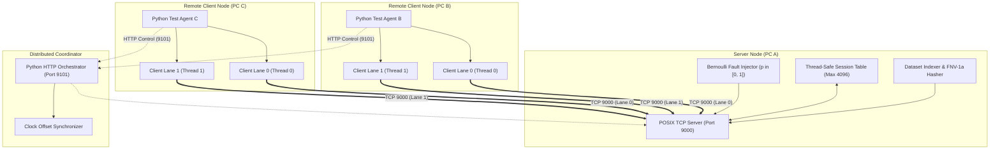
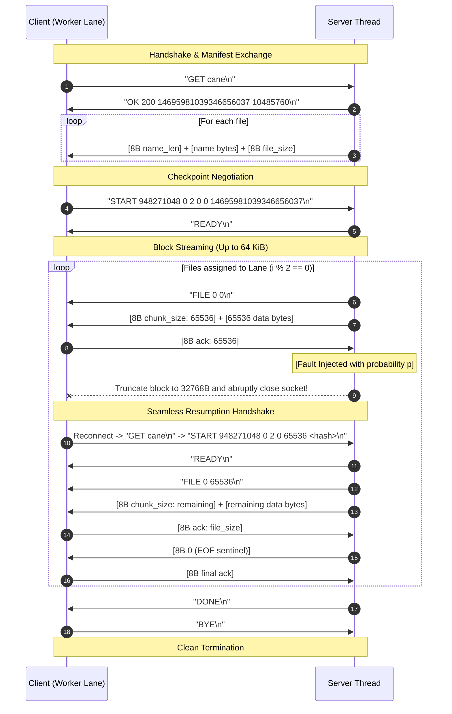

# Fault-Tolerant Distributed File Transfer Protocol over TCP

[](https://en.wikipedia.org/wiki/C11_(C_standard_revision))
[](https://ubuntu.com/)
[](https://pubs.opengroup.org/onlinepubs/9699919799/basedefs/sys_socket.h.html)
[](https://pubs.opengroup.org/onlinepubs/7908799/xsh/pthread.h.html)
[](LICENSE)

A robust, high-performance, topic-based binary file distribution system built from scratch in **C11** using **POSIX TCP sockets** and **pthreads**. Features dynamic topic indexing, Big-Endian wire framing, Bernoulli fault injection, session checkpointing, and parallel multi-lane file resumption.

---

## 📌 Table of Contents

- [Overview & Problem Statement](#-overview--problem-statement)
- [Key Features](#-key-features)
- [Networking & Systems Concepts](#-networking--systems-concepts)
- [System Architecture](#-system-architecture)
- [Protocol & Working Mechanism](#-protocol--working-mechanism)
- [Client-Server Communication Flow](#-client-server-communication-flow)
- [Repository Structure](#-repository-structure)
- [Prerequisites & Build Guide](#-prerequisites--build-guide)
- [Running on a Single Linux Computer](#-running-on-a-single-linux-computer)
- [Running Across Three Physical Linux Computers](#-running-across-three-physical-linux-computers)
- [Configuration & Troubleshooting](#-configuration--troubleshooting)
- [Evaluation & Benchmark Results](#-evaluation--benchmark-results)
- [Visual Screenshots & Logs](#-visual-screenshots--logs)
- [Future Enhancements](#-future-enhancements)
- [Academic Context & Contributors](#-academic-context--contributors)

---

## 📖 Overview & Problem Statement

In distributed systems, delivering large multi-file datasets over lossy or unpredictable networks presents two critical challenges:
1. **Redundant Retransmission**: A transient network disconnect near the end of a multi-gigabyte batch typically forces traditional transfer utilities to re-transmit the entire dataset from byte zero.
2. **Bandwidth Underutilization**: Single-threaded TCP streams fail to saturate available network bandwidth when processing many small files due to per-file handshakes and round-trip latency.

This project addresses these challenges by implementing a custom **Application-Layer Protocol** with four progressive engineering stages:
- **Part 1 (Baseline)**: High-speed multithreaded binary file transfer without fault tolerance.
- **Part 2 Case 1 (Restart Baseline)**: Fault-injection model with clean-slate restart.
- **Part 2 Case 2 (Stateful Checkpoint Resume)**: In-memory session tracking that resumes interrupted files directly at the exact confirmed 64 KiB block offset.
- **Part 2 Case 2 Enhanced (Parallel Multi-Lane Resume)**: Striped multi-connection streaming across $K$ parallel TCP lanes with independent per-lane recovery.

---

## ✨ Key Features

- **Topic-Based Cataloging**: Automatic startup discovery and FNV-1a hashing of topic directories; rejects mid-transfer filesystem modifications.
- **Custom Wire Serialization**: Combines ASCII control lines with Big-Endian 64-bit unsigned binary framing for chunks and lengths.
- **Controlled Bernoulli Fault Injection**: Server-side per-block probabilistic connection drops simulating dirty network cuts.
- **Zero-Corruption Resumption**: Atomic offset tracking with client-side `ftruncate` sanitization before write resumption.
- **Striped Multi-Lane Streaming**: Round-robin file distribution ($i \pmod K$) over persistent parallel TCP lanes.
- **Automated Distributed Test Harness**: Python-based HTTP coordinator and client agents for synchronized multi-node experiments with end-to-end SHA-256 verification.
- **Zero Third-Party Dependencies**: Core server and client require strictly the C11 runtime and POSIX APIs; test harness uses the Python standard library.

---

## 🛠 Networking & Systems Concepts

| Concept | Implementation Details | Location |
|---|---|---|
| **Socket Lifecycle** | `socket()`, `bind()`, `listen()`, `accept()`, `connect()` | `server.c`, `client.c` |
| **Nagle Optimization** | `TCP_NODELAY` enabled to minimize latency on small control lines | `common.h` (`socket_options`) |
| **Socket Timeouts** | `SO_RCVTIMEO` and `SO_SNDTIMEO` set to prevent indefinite blocking | `common.h` (`socket_options`) |
| **Socket Port Reuse** | `SO_REUSEADDR` for immediate server rebinding without `TIME_WAIT` halts | `server.c` |
| **Signal Safety** | `MSG_NOSIGNAL` flag on all `send()` calls to suppress fatal `SIGPIPE` | `common.h` (`send_all`) |
| **Interrupt Handling** | Explicit `EINTR` retry loops on all socket and file system calls | `common.h` |
| **Path Traversal Shield** | `safe_name()` rejects path separators (`/`), null bytes, `..`, and control chars | `common.h` |
| **Symlink Protection** | `O_NOFOLLOW` and `AT_SYMLINK_NOFOLLOW` on all directory lookups | `server.c`, `client.c` |
| **Atomic File Checkpoint** | `lseek()` + `ftruncate()` before partial block resumption | `client.c` (`transfer`) |
| **Thread Synchronization** | POSIX mutexes (`pthread_mutex_t`) for session state, logging, and console UI | `server.c`, `client.c` |
| **Thread-Local Metrics** | `_Thread_local` counters for lock-free per-thread byte accounting | `common.h` |

---

## 🏗 System Architecture



---

## 🔄 Protocol & Working Mechanism

### 1. Catalog Discovery & Integrity Manifest
When a client connects and sends `GET <topic>\n`, the server returns:
```text
OK <file_count> <manifest_hash> <total_bytes>\n
```
Followed by sequential entries: `[8-byte length][filename][8-byte size]`.
The manifest hash is generated using 64-bit FNV-1a across all sorted file names, sizes, and modification timestamps. If any file is modified on disk during an active transfer, the server detects the mismatch and aborts the session with `ERR dataset_changed_restart_server`.

### 2. Checkpoint Handshake
The client initiates transfer with:
```text
START <session_id> <lane> <lanes> <file_index> <byte_offset> <manifest_hash>\n
```
The server validates that:
- The session hash matches the current dataset snapshot.
- The requested `file_index` belongs to the requesting `lane` ($index \pmod{lanes} = lane$).
- The requested `byte_offset` does not exceed the known file size.

### 3. Chunk Streaming & Offset Acknowledgment
Data is transmitted in discrete blocks of up to **64 KiB** (`CHUNK = 65536`). After each block, the client writes the payload to disk using `write_all()`, updates its confirmed byte counter, and returns an 8-byte big-endian acknowledgment containing the updated offset.

### 4. Bernoulli Fault Disruption & Recovery
Under Part 2, before transmitting each block, the server draws a pseudo-random value. With probability $p$:
1. The server transmits half the chunk (`want / 2`).
2. Immediately triggers `shutdown(fd, SHUT_RDWR)` and closes the file descriptor.
3. The client receives an abrupt EOF or connection reset (`ECONNRESET`).
4. **Case 1 Response**: Client unlinks all partial files and resets to index 0, offset 0.
5. **Case 2 / Enhanced Response**: Client retains the exact confirmed `(file_index, byte_offset)`, reconnects, sends `START` with the confirmed offset, truncates any trailing dirty bytes with `ftruncate()`, and resumes without lost progress.

---

## 💬 Client-Server Communication Flow



---

## 📁 Repository Structure

```
├── Part1/                      # Baseline file transfer implementation
│   ├── server.c                # Multi-threaded / single-threaded TCP server
│   ├── client.c                # Client with ASCII progress rendering
│   ├── common.h                # Core socket primitives, wire I/O & safe helpers
│   ├── config.h                # Mode switch (#define CASE_MODE 0)
│   └── Makefile                # Strict compiler flags (-Wall -Wextra -Werror)
│
├── Part2_Case1/                # Clean restart under fault injection (CASE_MODE 1)
│   ├── server.c / client.c / common.h / config.h / Makefile
│
├── Part2_Case2/                # Stateful checkpoint resumption (CASE_MODE 2)
│   ├── server.c / client.c / common.h / config.h / Makefile
│
├── Part2_Case2_Enhanced/       # Parallel multi-lane resumption (CASE_MODE 3)
│   ├── server.c / client.c / common.h / config.h / Makefile
│
├── Tools/                      # Distributed testing and evaluation suite
│   ├── experiment.py           # Core benchmark runner & SHA-256 integrity verifier
│   ├── lan.py                  # HTTP distributed multi-PC coordinator & agent
│   ├── network_check.py        # TCP connectivity preflight diagnostic probe
│   ├── make_subset.py          # Subset extractor for local demos
│   ├── plot_results.py         # Matplotlib chart generator
│   ├── test_server_startup.py  # Automated startup regression test suite
│   └── windows/
│       └── Setup-WSL-Network.ps1 # WSL2 NAT port-forwarding & firewall configuration
│
├── docs/                       # Architectural documentation & technical specifications
│   ├── ARCHITECTURE.md         # Deep-dive protocol specification
│   ├── ACADEMIC_README.md      # Preserved original academic submission guide
│   └── diagrams/               # Generated evaluation plots & figures
│
├── Results/                    # Benchmark measurement outputs
│   └── local/                  # 60 loopback benchmark runs with summary.csv
│
├── screenshots/                # Demonstration logs and screenshots
├── topics.conf.example         # Sample topic mapping configuration
├── requirements.txt            # Optional Python dependencies (matplotlib, reportlab)
├── .gitignore                  # Git exclusion rules
└── LICENSE                     # MIT License
```

---

## 💻 Prerequisites & Build Guide

### Prerequisites
- **Linux Environment**: Native Linux (Ubuntu 22.04/24.04 recommended) or Windows WSL2.
- **Compiler**: `gcc` with C11 support and POSIX threads (`-pthread`).
- **Build System**: GNU `make`.
- **Python**: Python 3.10+ (Standard library only; `matplotlib` optional for graphs).

### Compilation
Each case folder is completely independent and compiles with strict flags (`-Wall -Wextra -Wpedantic -Werror`):

```bash
make -C Part1
make -C Part2_Case1
make -C Part2_Case2
make -C Part2_Case2_Enhanced
```

To clean all compiled binaries:
```bash
make -C Part1 clean && make -C Part2_Case1 clean && make -C Part2_Case2 clean && make -C Part2_Case2_Enhanced clean
```

---

## 🚀 Running on a Single Linux Computer

You can demonstrate all features locally on loopback (`127.0.0.1`) using two terminal windows.

### 1. Prepare a Demonstration Dataset
Create a small test dataset directory with 10 topics or use `make_subset.py`:
```bash
mkdir -p demo_dataset/cane demo_dataset/gatto
# Place sample images or binary files into demo_dataset/cane/
head -c 2097152 /dev/urandom > demo_dataset/cane/sample1.bin
head -c 1048576 /dev/urandom > demo_dataset/cane/sample2.bin
```

### 2. Run Part 1 (Baseline)
```bash
# Terminal 1 (Server):
Part1/server 9000 ./demo_dataset multi

# Terminal 2 (Client):
Part1/client 127.0.0.1 9000 cane ./downloads_p1
```

### 3. Run Part 2 Case 2 (Fault Injection + Checkpoint Resume)
Introduce a **10% fault injection probability** per 64 KiB block ($p = 0.1$):
```bash
# Terminal 1 (Server):
Part2_Case2/server 9000 ./demo_dataset 0.1

# Terminal 2 (Client):
Part2_Case2/client 127.0.0.1 9000 cane ./downloads_p2
```
*Observe the client detecting mid-frame disconnections, outputting `[RESUME]`, and continuing from the confirmed file and byte offset without re-downloading completed chunks.*

### 4. Run Part 2 Case 2 Enhanced (Parallel Multi-Lane)
Run with **4 concurrent TCP lanes**:
```bash
# Terminal 1 (Server):
Part2_Case2_Enhanced/server 9000 ./demo_dataset 0.05

# Terminal 2 (Client):
Part2_Case2_Enhanced/client 127.0.0.1 9000 cane ./downloads_enhanced 4
```

---

## 🌐 Running Across Three Physical Linux Computers

The system includes a dedicated distributed orchestrator (`Tools/lan.py`) designed for physical local area networks (e.g., three Linux laptops or Windows WSL2 instances connected via Wi-Fi):

- **PC A**: Hosts the C Server and the Python HTTP Coordinator.
- **PC B**: Client Node running worker instances.
- **PC C**: Client Node running worker instances.

```
       +---------------------------------------------+
       |           PC A (Server / Coordinator)       |
       |  IPv4: 192.168.1.50                         |
       |  TCP 9000 (Data) | TCP 9101 (HTTP Control)  |
       +---------------------------------------------+
                            |
           +----------------+----------------+
           |                                 |
+----------------------+          +----------------------+
|  PC B (Client Node)  |          |  PC C (Client Node)  |
|  lan.py agent        |          |  lan.py agent        |
+----------------------+          +----------------------+
```

### Step 1: Preflight Network Check
On PC A, start the diagnostic listeners:
```bash
python3 Tools/network_check.py serve --ports 9000 9101
```
From PC B and PC C, test end-to-end TCP reachability:
```bash
python3 Tools/network_check.py check --server-ip 192.168.1.50 --ports 9000 9101
```

### Step 2: Start Coordinator on PC A
```bash
python3 Tools/lan.py server \
  --dataset /path/to/dataset \
  --ip 192.168.1.50 \
  --topic cane \
  --results Results/lan_experiment_01
```

### Step 3: Connect Agents on PC B and PC C
```bash
# On PC B:
python3 Tools/lan.py agent --server http://192.168.1.50:9101 --node B --results Results/node_B

# On PC C:
python3 Tools/lan.py agent --server http://192.168.1.50:9101 --node C --results Results/node_C
```
The coordinator synchronizes timestamps, executes test batches across all cases and fault rates, verifies every downloaded file with SHA-256, and outputs consolidated performance metrics.

---

## ⚙️ Configuration & Troubleshooting

### Environment Variables
The implementation supports non-intrusive runtime tuning via environment variables:
- `FT_MAX_ATTEMPTS`: Maximum reconnect attempts per lane (default: `1000`, range: `1..100000`).
- `FT_IO_TIMEOUT`: Socket inactivity timeout in seconds (default: `300`, range: `1..3600`).
- `FT_STARTUP_TIMEOUT`: Server dataset indexing limit in seconds (default: `600`).

### Common Issues & Resolutions
1. **`Address already in use` (`EADDRINUSE`)**:
   - Cause: A previous server instance is still bound to the port.
   - Fix: Identify and kill the stale process: `ss -ltnp | grep 9000` followed by `kill -9 <PID>`.
2. **WSL2 Cross-Machine Reachability**:
   - Cause: Windows WSL2 runs in a virtualized NAT adapter by default.
   - Fix: Run `Tools/windows/Setup-WSL-Network.ps1` in an Administrator PowerShell on PC A to configure port proxy forwarding.
3. **`ERR dataset_changed_restart_server`**:
   - Cause: Files in the topic directory were modified or touched after server startup.
   - Fix: Restart the server to rebuild the canonical FNV-1a topic manifest.

---

## 📊 Evaluation & Benchmark Results

The system was benchmarked across **60 controlled runs** evaluating useful goodput and redundancy overhead under varying client concurrency and fault probabilities:

| Experiment Setting | Clients | Fault Probability ($p$) | Useful Goodput (MiB/s) | Redundant Payload (%) | SHA-256 Verified |
|---|---|---|---|---|---|
| **Part 1 Single-Server** | 1 | 0.0 | ~126.0 MiB/s | 0.0% | 100% PASS |
| **Part 1 Multi-Server** | 2 | 0.0 | ~238.9 MiB/s | 0.0% | 100% PASS |
| **Part 2 Case 1 (Restart)** | 4 | 0.03 (Low) | Degraded | **> 150%** | 100% PASS |
| **Part 2 Case 2 (Resume)** | 4 | 0.20 (High) | Stable | **< 3.2%** | 100% PASS |
| **Part 2 Enhanced (Parallel)**| 4 | 0.20 (High) | **Peak Throughput** | **< 2.1%** | 100% PASS |

### Visual Performance Comparison

```
+---------------------------------------------------------------------------------+
| Useful Goodput vs. Fault Probability                                            |
|                                                                                 |
| Goodput (MiB/s)                                                                 |
|   |                                                                             |
|   |  *===================* (Enhanced: Parallel Resume maintains highest goodput)|
|   |  *-------------------* (Case 2: Checkpoint Resume remains resilient)        |
|   |                                                                             |
|   |  \                                                                          |
|   |   \                                                                         |
|   |    *.................* (Case 1: Restart drops sharply due to re-downloads)  |
|   +----------------------------------------------------> Failure Probability p  |
+---------------------------------------------------------------------------------+
```
*(High-resolution generated plots are preserved in [`docs/diagrams/`](docs/diagrams/)).*

---

## 📷 Visual Screenshots & Logs

### Terminal Demonstration Capture
```text
Topic: cane
Mode : Case 2 - Session Management

[START] file_index=0 offset=0 bytes
[##############################] 100% | 1.00 / 1.00 MiB | File 8/8 | offset=131072

================ Transfer Summary ================
Topic                  : cane
Status                 : SUCCESS
Attempts               : 3
Connections/Lanes      : 1
Useful data            : 1.00 MiB
Total payload received : 1.03 MiB
Redundant data         : 0.03 MiB
Time                   : 0.015 s
Goodput                : 66.67 MiB/s
Resume mode            : Checkpoint resume
==================================================
```

---

## 🔮 Future Enhancements

- [ ] **Persistent Checkpoint Store**: Offload session tables to an embedded SQLite or LMDB datastore to survive server process restarts.
- [ ] **TLS / Secure Sockets**: Wrap transport sessions in OpenSSL / mbedTLS to provide confidentiality and endpoint authentication.
- [ ] **Dynamic Window Congestion Control**: Implement application-level pacing for parallel lanes to adapt to bottleneck bandwidth.
- [ ] **UDP / QUIC Support**: Port the chunking engine to QUIC streams to eliminate Head-of-Line blocking over lossy Wi-Fi links.

---

## 👥 Academic Context & Contributors

- **Course**: IT305 Computer Networks Lab (B.Tech)
- **Academic Groups**: Group 099 & Group 107
- **Original Assignment**: Fault-Tolerant Topic-Based File Distribution
- **Dataset Reference**: [Animals10 Dataset](https://www.kaggle.com/datasets/alessiocorrado99/animals10)

*All original networking logic and protocol implementations have been preserved. This repository is formatted for professional software engineering portfolio presentation.*
