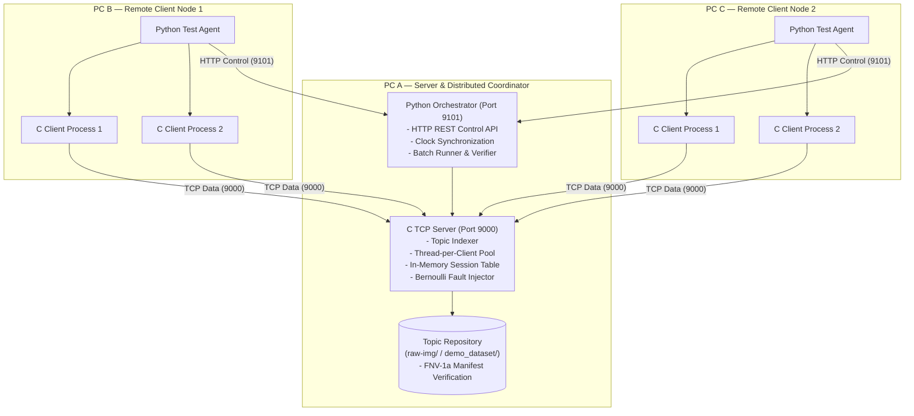
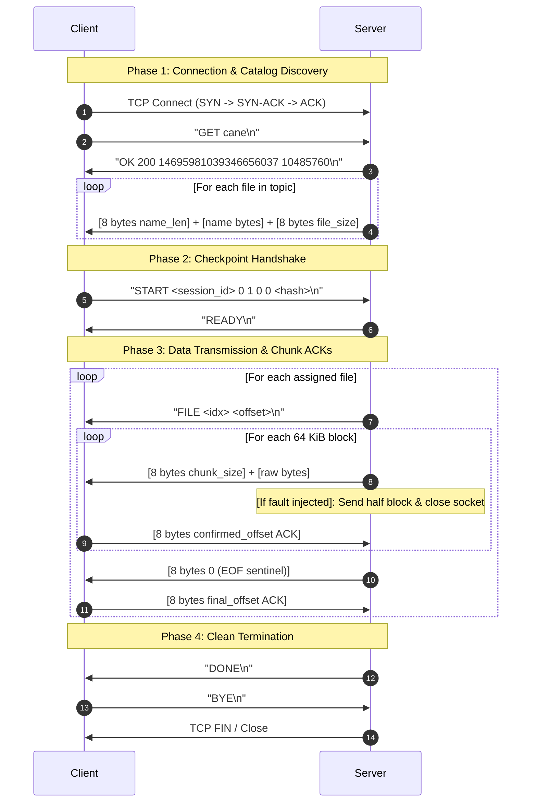

# Protocol & System Architecture Specification

## 1. Overview & System Goals

This system is a high-performance, fault-tolerant topic-based file distribution protocol implemented in C11 using POSIX sockets (`AF_INET`, `SOCK_STREAM`) and POSIX threads (`pthreads`).

The system enables one or more concurrent clients to request and receive collections of binary files organized into named **topics** from a centralized server. Under network instability—such as mid-stream TCP connection interruptions—the protocol provides verified recovery guarantees.

---

## 2. Distributed Architecture

---

## 3. Wire Protocol & Message Framing

The wire protocol combines **ASCII line framing** for control signalling and **Big-Endian binary framing** for file metadata, chunk lengths, and acknowledgment offsets.

### 3.1 Control Message Syntax (ASCII `\n`-terminated)

| Command | Direction | Parameters / Format | Description |
|---|---|---|---|
| `GET` | Client → Server | `GET <topic_name>\n` | Requests topic catalog manifest. |
| `OK` | Server → Client | `OK <count> <hash> <total_bytes>\n` | Manifest header response. |
| `ERR` | Server → Client | `ERR <reason>\n` | Protocol or validation error code. |
| `START` | Client → Server | `START <id> <lane> <lanes> <idx> <offset> <hash>\n` | Requests file transfer initiation or resumption. |
| `READY` | Server → Client | `READY\n` | Confirms checkpoint validation and stream start. |
| `FILE` | Server → Client | `FILE <file_index> <starting_offset>\n` | Signals transmission of a specific file. |
| `DONE` | Server → Client | `DONE\n` | All files in lane delivered and verified. |
| `BYE` | Client → Server | `BYE\n` | Clean client disconnect signal. |

### 3.2 Binary Data Framing (Big-Endian 64-bit)

- **Manifest Entry**:
  - `put64(name_length)`: 8-byte big-endian length of filename.
  - `send_all(filename)`: ASCII bytes of filename.
  - `put64(file_size)`: 8-byte big-endian file size in bytes.
- **Payload Block**:
  - `put64(chunk_size)`: 8-byte big-endian byte count of following block ($1 \le \text{chunk\_size} \le 65536$).
  - `send_all(payload)`: raw payload bytes.
  - `get64(&ack_offset)`: Client sends confirmed cumulative byte offset after complete disk write.
- **End-of-File Sentinel**:
  - `put64(0)`: 8-byte zero indicates end-of-file.
  - `get64(&ack)`: Client acknowledges file completion.

---

## 4. Client-Server Communication Flow

---

## 5. Recovery Models Comparison

| Mechanism | Part 1 (`CASE_MODE=0`) | Part 2 Case 1 (`CASE_MODE=1`) | Part 2 Case 2 (`CASE_MODE=2`) | Part 2 Case 2 Enhanced (`CASE_MODE=3`) |
|---|---|---|---|---|
| **Fault Injection** | Disabled ($p=0$) | Enabled ($p \ge 0$) | Enabled ($p \ge 0$) | Enabled ($p \ge 0$) |
| **Server Concurrency** | Single or Multi-threaded | Multi-threaded | Multi-threaded | Multi-threaded |
| **Client TCP Connections** | 1 connection | 1 connection | 1 connection | $K$ parallel connections ($1 \le K \le 16$) |
| **Disconnection Behavior** | Fails transfer | Discards all files (`unlinkat`) & restarts byte 0 | Resumes from last confirmed file & offset | Resumes only the interrupted lane |
| **Session Tracking** | None | None | In-memory session table `(id, lane)` | In-memory table for each `lane` |
| **Overhead under Loss** | N/A | High (entire topic retransmitted) | Low (only unconfirmed chunk retransmitted) | Minimal (only interrupted lane retransmits) |

---

## 6. Fault Injection Model

Under Part 2, before each payload chunk (up to 64 KiB), the server conducts an independent **Bernoulli trial** with probability $p$:

$$P(\text{disconnect}) = p$$

When a fault triggers:
1. The server truncates the payload chunk to `chunk_size / 2`.
2. Transmits the partial block to the wire.
3. Immediately closes the TCP socket without reading the ACK (`SHUT_RDWR + close`).
4. Logs detailed fault metadata (`session`, `lane`, `file_index`, `confirmed_offset`, `disconnect_offset`).

This simulates dirty mid-packet physical drops, testing both client error detection and offset recovery.

---

## 7. Parallel Multi-Lane Striping Algorithm

In **Part 2 Case 2 Enhanced**, the client initiates $K$ concurrent worker threads and opens $K$ independent TCP sessions:

$$\text{Lane Assignment: File } i \text{ is assigned to Lane } l \iff i \equiv l \pmod K$$

Each lane:
- Maintains its own random session ID and lane index $l \in [0, K-1]$.
- Transmits an independent `START` request specifying `lane=l` and `lanes=K`.
- Interleaved file execution allows parallel disk writes and saturates available network bandwidth.
- If Lane $A$ disconnects, Lane $B$ continues streaming unaffected; only Lane $A$ reconnects and resumes.

